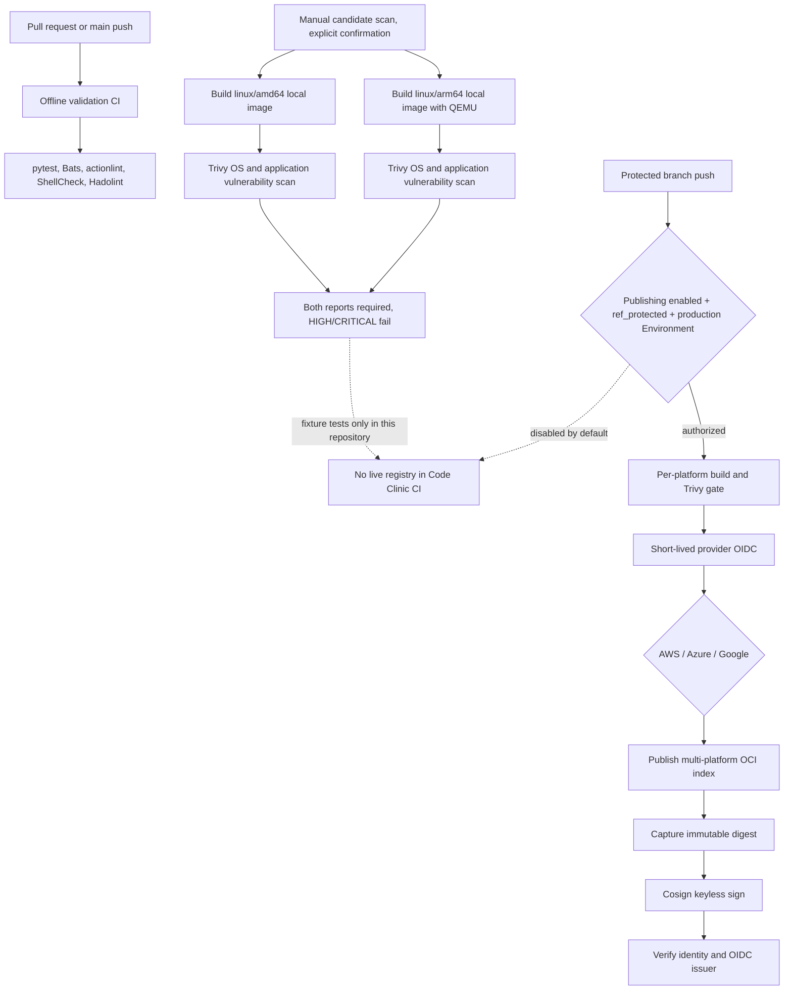

# Multi-Architecture Container Security Pipeline

Code Clinic Lab 6 implements a reusable GitHub Actions supply-chain pattern for building Linux AMD64 and ARM64 images, scanning each platform image, enforcing a HIGH/CRITICAL gate, and publishing and signing by immutable digest only behind protected-branch and environment controls.

## Original assignment

> Create a GitHub Actions workflow (or GitLab CI) that builds a multi-arch Docker image, scans it with Trivy, signs it with Cosign, and pushes to ECR/ACR/GCR only on protected branches.

## Problem and architecture

Organizations running x86_64 and ARM64 workloads across AWS, Azure, and Google Cloud need consistent image controls without long-lived cloud keys. Pull request validation has read-only repository permissions and no cloud identity. A separately gated workflow builds each platform image and scans it before the reusable publication workflow can obtain OIDC credentials.



The lower production path is a workflow definition only. Repository CI never authenticates to a cloud, builds/pushes a release image, or signs a registry artifact. The candidate scanner is a manual, explicitly confirmed workflow that downloads Trivy's vulnerability database; ordinary validation CI uses offline fixtures.

## Technology

- GitHub Actions, Buildx, and QEMU build separate `linux/amd64` and `linux/arm64` local candidates.
- Trivy scans the platform-specific local image for OS and application package vulnerabilities; HIGH and CRITICAL fail the gate.
- Cosign keyless signing uses GitHub OIDC and signs `image@sha256:...`; verification pins both certificate identity and issuer.
- AWS ECR uses GitHub OIDC with `configure-aws-credentials` and ECR login. Azure ACR uses `azure/login` federation. Google Artifact Registry uses Workload Identity Federation. Google Artifact Registry is the current service; legacy GCR is a distinct older registry.
- ShellCheck, shfmt, Hadolint, actionlint, pytest, and Bats validate the project.

## Repository map

`app/` contains the small HTTP demonstration service. `Dockerfile` creates a minimal non-root runtime image and OCI metadata labels. `scripts/` contains the Trivy evaluator, digest/reference validation, Cosign verification, and config validation. `config/` has disabled-by-default examples. `.github/workflows/` contains offline validation, a candidate scanner, protected publication entrypoint, and reusable publisher. `tests/fixtures/` contains synthetic reports; `docs/` describes threat controls and cloud setup.

## Prerequisites

For local tests: Python 3.12+, Bash, pytest, PyYAML, and optionally Bats, ShellCheck, shfmt, Hadolint, and actionlint. Docker and cloud credentials are not needed for offline tests. A candidate scan requires Docker, QEMU/Buildx, network access to Trivy's vulnerability database, and a protected branch; it still does not publish an image.

## Local validation

```bash
python -m venv .venv
source .venv/bin/activate
python -m pip install -e '.[test]'
python -m pytest -q
python scripts/validate_config.py config/pipeline.example.yaml
bats tests/*.bats
shellcheck scripts/*.sh
shfmt -d scripts/*.sh
actionlint
hadolint Dockerfile
```

To evaluate fixtures directly:

```bash
bash scripts/evaluate-trivy.sh \
  --amd64 tests/fixtures/trivy-clean-amd64.json \
  --arm64 tests/fixtures/trivy-clean-arm64.json \
  --summary /tmp/security-summary.json
```

The script exits `0` only when both valid scan reports pass, `1` for missing, malformed, or violating reports, and `2` for invalid invocation or policy. It emits a JSON summary. The evaluator counts severities across Trivy result entries and treats absent/malformed architecture reports as failure.

## Build and scan design

Buildx emits each platform as a local single-platform image, separately tagged with the source SHA and architecture. QEMU enables ARM64 emulation on an AMD64 hosted runner. Trivy scans that architecture-specific image; the workflow does not claim that scanning one OCI index or runner-native image covers both architectures. The reusable publishing flow rebuilds the OCI multi-platform index from the same commit after the scan gate. Because base image tags and build tooling can change between jobs, this does not prove the published bytes exactly match the scanned candidates. Pin all base images by digest and promote a previously scanned artifact by digest when exact artifact identity is required. A staging registry can provide that stronger design, but is intentionally not used here.

Trivy version is set in the candidate scanner image reference. Database update occurs only in that explicitly invoked scanner workflow. Keep the vulnerability DB fresh for operational scans; record the timestamp and DB metadata with scan results. The exception ledger example is not automatically applied to scans: translate only approved exceptions into Trivy ignore-file syntax as a reviewed change, with owner, rationale, tracking issue, and expiration. No ignore rule is active by default.

## Signing and verification

After publishing, the reusable workflow reads Buildx's immutable digest output and signs `REGISTRY/REPOSITORY/IMAGE@sha256:DIGEST` with keyless Cosign. It then verifies the signature with the configured certificate identity and `https://token.actions.githubusercontent.com` issuer. Registry support for Cosign OCI signature artifacts must be checked for the chosen provider. The offline fixtures test input validation and gate behavior; they do not simulate a live signature or registry.

## Cloud configuration

All registries and publishing are disabled by default. The example account, tenant, subscription, registry, and project values are synthetic or reserved documentation placeholders. An authorized administrator must create cloud-side federated trust and configure GitHub repository variables and the `production-publish` Environment outside this project. Do not add static access keys.

- **AWS ECR:** configure `AWS_PUBLISH_ROLE_ARN`, `AWS_REGION`, `REGISTRY_HOST`, and `REGISTRY_REPOSITORY`; scope the role to only the intended ECR repository. Required push permissions include authorization token and image layer/manifest upload operations.
- **Azure ACR:** configure `AZURE_CLIENT_ID`, `AZURE_TENANT_ID`, `AZURE_SUBSCRIPTION_ID`, `AZURE_REGISTRY_NAME`, and registry host/repository variables. Federated credential subject must match this repository and protected Environment; grant only the registry push role.
- **Google Artifact Registry:** configure `GCP_WORKLOAD_IDENTITY_PROVIDER`, `GCP_PUBLISHER_SERVICE_ACCOUNT`, `GAR_HOST`, registry host/repository variables. Restrict the pool provider condition to this repository, protected ref, and Environment; grant Artifact Registry Writer only on the required repository.

Provider authentication actions in the example must be maintained at reviewed immutable commit SHAs. Cloud organization policies and federated trust policies remain the final identity boundary.

## Protected branch and publication safety

The publication entrypoint requires an authorized push or separately confirmed dispatch, `github.ref_protected`, an explicit `PUBLISHING_ENABLED=true` repository variable, and the `production-publish` Environment. A branch called `main` is not automatically protected. Administrators must configure branch protection/rulesets, Environment branch restrictions and required reviewers, and cloud OIDC trust constraints. Pull requests and forks do not receive `id-token: write`; only the publishing reusable job has it. Manual dispatch alone is insufficient.

Validation CI has only `contents: read`. No `pull_request_target` is used. Action references are pinned to full commit SHAs. Workflows use timeouts and concurrency controls. Do not share untrusted caches or artifacts with publishing jobs; isolate trusted publishing runners and review workflow changes as privileged code.

## Repeatability and release safety

Container publication is not Terraform-style reconciliation. A commit-SHA tag aids traceability, while the digest is the artifact identity. Re-running may rebuild different bytes if base images, package indexes, timestamps, or builder versions changed. Configure registry tag immutability, treat digest signing as repeatable for the same digest, and make duplicate signatures safe to verify. Limit concurrent publication per repository/ref. Promote images across environments by digest rather than rebuilding by mutable tag. Do not claim bit-for-bit reproducibility without verifying every input.

## CI checks

`.github/workflows/ci-validation.yml` runs on PRs and main pushes. It has no cloud login, OIDC permission, image push, or signing. It validates application/config behavior, security and workflow contracts, shell scripts, Dockerfile conventions, and workflow syntax. The manual candidate scanner is separate and requires an explicit boolean confirmation on a protected ref.

## Troubleshooting

- **Buildx/QEMU errors:** inspect the selected runner architecture and setup-QEMU logs; test each platform separately.
- **ARM64 failures:** ensure the build does not assume an x86-only binary and that native dependencies support aarch64.
- **Trivy findings or unavailable DB:** confirm scanner version, database freshness, architecture-specific tag, and report path. Missing reports fail closed.
- **Cosign verify failure:** confirm the image digest, registry signature artifact support, expected GitHub workflow identity, and OIDC issuer.
- **OIDC denied:** check cloud federated subject/issuer/audience conditions, protected ref, repository variables, and Environment approval.
- **Registry push denied:** verify least-privilege repository-scoped permissions and correct hostname/repository values.
- **Publication skipped:** verify branch protection status, `PUBLISHING_ENABLED`, provider configuration, event type, and Environment restrictions.
- **Unsupported registry:** only `aws`, `azure`, and `gcp` are accepted by the protected publication gate.

## Limitations and future work

This lab does not authenticate to AWS, Azure, or Google Cloud; create cloud resources; push images; create live registry signatures; or modify GitHub settings. It has not verified live cloud authentication or signing. Publishing is disabled by default and must remain disabled in a Code Clinic checkout. Offline tests do not prove end-to-end cloud behavior. For stronger supply-chain evidence, add SBOM generation, SLSA provenance with a verified builder, in-toto attestations, admission policy, and digest-based promotion. A provenance file alone does not make a build SLSA compliant.
